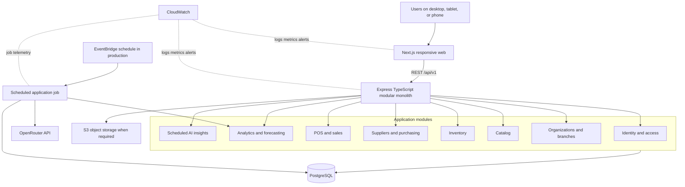
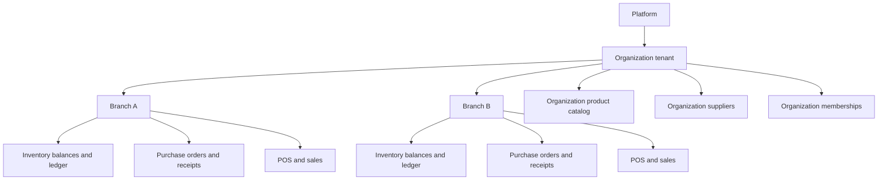
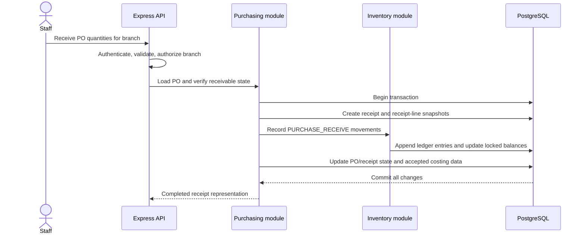
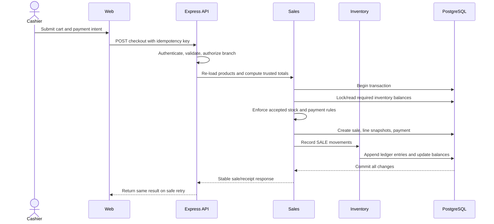
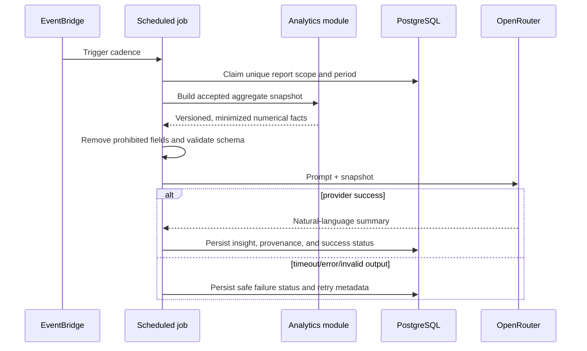
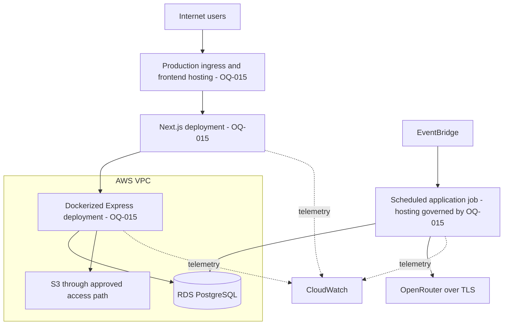

# StockWise Architecture

| Field | Value |
| --- | --- |
| Status | Architecture Freeze v1; accepted logical architecture; minimal web/API shells implemented |
| Baseline | Architecture Freeze v1 |
| Last updated | 2026-08-22 |

## 1. Scope and authority

This document is the Source of Truth for system boundaries, component responsibilities, data flows, module dependency rules, tenancy, and conceptual deployment. Product requirements are owned by `BUILD_SPEC.md`; physical tables by `docs/DATABASE.md`; formulas by `docs/ANALYTICS.md`; and HTTP contracts by `docs/API.md`.

The repository layout is accepted by `ADR-011`. The exact production hosting topology (`OQ-015`) remains unresolved. Diagrams below are logical, not a claim that infrastructure exists.

## 2. Architecture summary

StockWise is a TypeScript modular monolith with two primary runtime applications:

- A responsive Next.js web application
- An Express REST API containing explicit business-domain modules

PostgreSQL is the system of record. Prisma owns application data access and migrations. Deterministic analytics and forecasts run in TypeScript/SQL. Scheduled jobs build aggregate snapshots and call OpenRouter only for natural-language summaries.



Only the minimal Next.js web shell, Express API transport shell, root-level operational probes, and a development-only local PostgreSQL Docker Compose baseline are implemented. The API exposes no business endpoints or domain modules; Prisma, AWS resources, and diagrammed integrations do not exist yet.

### Repository boundaries

The native pnpm workspace uses these physical boundaries:

```text
stockwise/
  apps/
    web/                 # Next.js App Router shell under src/app
    api/                 # Express transport shell and future modular monolith
      src/modules/       # Business modules remain inside the API application
      prisma/            # API-owned Prisma schema and migrations
  packages/              # Deliberately shared internal packages only when justified
  docs/                  # Architecture and technical Source of Truth documents
  tests/e2e/             # Future cross-application end-to-end tests
  infra/                 # Future deployment/infrastructure configuration
```

Only `apps/*` and `packages/*` are package-manager workspaces. Tests should normally be colocated with their owning application or module; `tests/e2e` is reserved for cross-application workflows. `packages` must not become a catch-all shared layer, and no package is created there without a concrete consumer and dependency rationale. The scheduled job remains an API application entry point unless a later accepted ADR demonstrates a separate deployment need.

## 3. Architecture style: modular monolith

The backend is one deployable application divided by business capability. Modules have owned responsibilities and expose deliberate application interfaces. They do not become separately deployed services.

### Why this style

- The project and team are small enough that service orchestration would add cost without proven benefit.
- Checkout and receiving need strong transactions across sales/purchasing and inventory.
- Domain boundaries are still evolving.
- One TypeScript backend keeps deployment, security, logging, and local development manageable.
- A well-factored modular monolith preserves future extraction options if a measured scaling or ownership need emerges.

### Rules

- HTTP routing is an adapter, not the home of business rules.
- Module-owned application services coordinate use cases.
- Persistence queries must include trusted tenant/branch scope.
- Cross-module writes are coordinated by explicit use cases and one database transaction where atomicity is required.
- Domain modules may depend on small stable contracts; they must not import another module's internal repositories or controllers.
- No module may call another StockWise module over HTTP inside the same application.
- Adding a separately deployable service, queue, or second language requires an accepted ADR.

## 4. Logical component responsibilities

| Component | Responsibilities | Must not do |
| --- | --- | --- |
| Next.js web | Responsive UI, navigation, accessibility, local interaction state, TanStack Query server state, render charts, send validated user intent | Establish trusted tenant scope, calculate authoritative price/totals, mutate stock directly, call OpenRouter |
| Express API edge | Route `/api/v1`, authenticate, validate with Zod, authorize, invoke use cases, map errors, emit request telemetry | Contain domain calculations in controllers, trust client totals/scope |
| Identity and access | Email/password identity, Argon2 verification, opaque PostgreSQL-backed sessions, provider-abstracted verification/reset/invitation email, organization membership, branch assignment, fixed RBAC policy | Infer access from client-provided IDs or couple auth-domain behavior directly to Resend |
| Organizations and branches | Tenant lifecycle, branch lifecycle, active/allowed scope resolution | Own product, sale, or inventory business rules |
| Catalog | Organization products/categories, SKU/barcode rules, status and current price data | Hold branch inventory as `product.stock`; rewrite sale history |
| Inventory | Branch balances, append-oriented ledger, adjustments, stock availability, movement history | Change balances without ledger records; decide `OQ-007` itself |
| Suppliers and purchasing | Organization suppliers, branch-targeted purchase orders, receipt lifecycle | Update inventory outside an atomic receiving use case |
| POS and sales | Server-side cart validation, checkout, immutable line snapshots, payment records, history, receipt views, reversal after rules are accepted | Trust prices/totals from browser; commit a partial checkout |
| Analytics and forecasting | Accepted metric formulas, period boundaries, branch/organization aggregation, deterministic forecast and evaluation | Ask an LLM to calculate or forecast; invent unresolved formulas |
| Scheduled AI insights | Snapshot creation, minimization, prompt version, provider call, idempotency, persistence, retry/failure status | Query raw database through OpenRouter; block core workflows |
| PostgreSQL | System of record, constraints, transactions, indexes, balances, ledgers, snapshots, persisted insights | Serve as an authorization substitute without scoped queries |
| S3 | Object assets only when required, such as product images or generated report assets | Store transactional truth that belongs in PostgreSQL |
| EventBridge | Production cadence trigger for scheduled report work | Define business-period semantics |
| CloudWatch | Operational logs, metrics, dashboards, and alerts | Receive secrets, raw passwords, or unnecessary personal data |
| SQS (conditional) | Buffer background work only after measured need and accepted ADR | Be a default dependency or source of transactional truth |

## 5. Tenant and branch boundaries



### Accepted invariants

1. `Organization` is the tenant boundary.
2. `Branch` belongs to one organization.
3. Product/category/supplier belongs to one organization.
4. Inventory balance/transaction, purchase order/receipt, and sale/payment belongs to one branch.
5. A branch-owned record's organization must equal the organization of every organization-owned resource it references.
6. A user can have organization-wide access and/or access to multiple branches.
7. An organization aggregate is computed only from branches visible to the actor.
8. Background jobs execute with an explicit organization and report scope, not an unrestricted global query accidentally reused from request code.

### Trusted request context

Conceptually, the API establishes:

```text
Authenticated actor
  + verified organization membership
  + verified branch assignment when branch-scoped
  + role permission for action/resource
  = authorized request context
```

Path/query/body fields select a candidate resource; they never grant access. Cross-tenant records should be reported without revealing their existence.

### Authorization policy convention

P2-M1-T03 establishes the API-owned, pure policy foundation at
`apps/api/src/modules/identity/authorization-policy.ts`. It owns the fixed
typed permission vocabulary, server-resolved authorization context, trusted
organization/branch resource scopes, and the centralized `can(context,
permission, resourceScope)` decision. It issues no database query and is not
wired into Express until authentication middleware and protected use cases
exist.

- A trusted context is constructed only from server-resolved actor,
  membership, and branch-assignment state. It retains the actor and membership
  identities, active/disabled states, organization role, and active assigned
  branch IDs; actor/membership or assignment organization mismatches fail
  closed.
- A trusted branch scope carries both the requested organization and the
  branch's resolved owning organization. A mismatch fails before a role can
  receive organization-wide or branch-assignment access.
- `OWNER` and `ADMIN` may use organization scope and every branch in their
  organization. `BRANCH_MANAGER`, `INVENTORY_STAFF`, and `CASHIER` must use an
  actively assigned branch scope; organization scope and zero or inactive
  assignments deny access.
- The vocabulary includes the accepted catalog, supplier, inventory,
  purchasing/receiving, checkout, sales-history, analytics, forecast/reorder,
  AI-summary, and governance capabilities. It excludes refund/void authority
  until `OQ-009` is resolved. `ADMIN` can manage only non-owner memberships;
  OWNER membership, ownership transfer, and destructive ownership actions are
  OWNER-only. The later membership mutation transaction must still preserve the
  last-active-OWNER invariant.

## 6. Critical data flows

### 6.1 Authentication and scope selection

1. The client sends credentials over TLS.
2. The API validates the request and verifies the Argon2 password hash.
3. The API rotates a cryptographically random opaque session, sends it only in an HttpOnly cookie, and stores only its hash in PostgreSQL.
4. For each protected request, the API resolves the actor, account status, membership, and branch assignment from trusted session state.
5. If a branch is selected, the API verifies that it belongs to the active organization and that the actor has branch or organization permission.
6. The client receives only accessible organizations/branches and permissible actions.

The browser never receives a JWT or refresh token and never stores an auth token in `localStorage` or `sessionStorage`. Session expiry/revocation, including disabled or deauthorized actors, is evaluated server-side. The cookie is host-only, `SameSite=Lax`, and `Secure` in production; configurable timeout baselines are 24 hours idle and seven days absolute.

### 6.2 Purchase receiving



Any validation, authorization, state, cost, quantity, or database error rolls back the complete operation. Partial/over-receiving and cost behavior are blocked by `OQ-021` and `OQ-010`.

### 6.3 POS checkout



The operation must never leave a completed sale without its matching inventory and payment records. Negative-stock and payment semantics remain blocked by `OQ-007` and `OQ-008`.

### 6.4 Deterministic analytics

1. The actor requests a period, branch, or allowed organization aggregate.
2. The API resolves authorization and canonical period boundaries.
3. Analytics reads only accepted completed-sale/inventory states once `OQ-011` is closed.
4. SQL performs set aggregation; TypeScript applies accepted formulas where appropriate.
5. The response includes period, scope, metric version, data completeness, and values.
6. Reusable scheduled snapshots may be stored to avoid repeated expensive computation.

`docs/ANALYTICS.md` exclusively owns formulas and period semantics.

### 6.5 Scheduled AI insight



Dashboard reads the persisted result. Opening or refreshing the dashboard does not call OpenRouter. Scheduled job mechanics, model/fallback, and schedule times are governed by `OQ-017` and `OQ-018`.

## 7. Data ownership and module interactions

| Owning module | Owns | Authorized collaborating use cases |
| --- | --- | --- |
| Identity/access | Users, memberships, branch assignments, role policy | All modules ask it to establish/check actor scope |
| Organizations/branches | Organization and branch lifecycle | Catalog/inventory/purchasing/sales validate ownership |
| Catalog | Categories and products | Inventory references product; purchasing/sales snapshot product data |
| Inventory | Balance and transaction ledger | Receiving adds; checkout subtracts; approved reversal compensates |
| Purchasing | Supplier, purchase order, receipt | Receiving coordinates inventory and accepted costing |
| Sales | Sale, line snapshots, payment, receipt/reversal lifecycle | Checkout/reversal coordinates inventory |
| Analytics | Metric queries/snapshots/forecast/evaluation | Reads stable operational data; supplies aggregate AI snapshot |
| AI insights | Insight job/run/output/provenance | Reads validated analytics snapshot only |

Owning a table does not mean bypassing another module's invariant. For example, Sales does not directly decrement an arbitrary balance; the checkout use case invokes the inventory contract inside the same transaction.

## 8. Frontend architecture responsibilities

- Use Next.js and TypeScript for the responsive web client.
- Use TanStack Query for remote server state and cache invalidation.
- Use Tailwind CSS and shadcn/ui for the component system.
- Use Recharts for accessible, labeled chart views; provide textual/tabular alternatives for critical numbers.
- Keep authorization enforced on the API even if the UI hides inaccessible actions.
- Treat selected organization/branch as navigation context, not proof of permission.
- Present loading, empty, stale, partial-data, error, and retry states.
- Never compute authoritative checkout prices or analytics in the browser.
- Do not add a native wrapper or offline mutation queue within the current scope.
- Use the Next.js App Router with the `src/app` directory convention; do not use the Pages Router.
- Keep React Server Components as the default and add `"use client"` only at boundaries that require state, effects, event handlers, browser APIs, or client-only providers.
- Add Route Groups such as `(auth)` or `(app)` only when implemented routes justify them; do not create speculative route structure.
- Keep StockWise core and business REST APIs in the Express application. Do not implement them as Next.js Route Handlers.
- During local development, the browser reaches the Express operational health
  probe through the Next.js same-origin `/api/health` rewrite. The rewrite targets
  the API's loopback origin and avoids enabling broad browser-to-API CORS.

## 9. Backend layering

Within `apps/api`, each module must preserve these responsibilities:

```text
HTTP route/controller
        |
validation + authenticated context
        |
application use case
        |
domain rules / module contracts
        |
Prisma-backed persistence and external adapters
```

- Controllers map HTTP to application input/output.
- Zod schemas validate external shape and basic constraints.
- Application use cases coordinate authorization, transactions, and modules.
- Domain rules express invariant decisions independent of Express.
- Persistence adapters issue scoped queries and translate database errors.
- External adapters isolate OpenRouter, S3, scheduler, logging, and time.

Avoid a generic repository abstraction that erases query semantics, tenant scope, locking, or transaction requirements.

## 10. Data consistency strategy

### Strong consistency required

- Checkout and inventory deduction
- Receiving and inventory addition
- Adjustments and balance changes
- Refund/void reversal once defined
- Uniqueness and membership constraints
- Idempotent creation of a sale, receipt, snapshot, and scheduled report

### Derived/read models

- `InventoryBalance` is a transactionally maintained projection of ledger movements.
- Analytics snapshots and AI insights are derived and reproducible from operational truth, subject to versioning and retention rules.
- A stale AI insight is acceptable and must be labeled; a stale or inconsistent stock balance is not.

No event-driven eventual consistency is required for the core MVP flows.

## 11. AWS deployment boundaries

Accepted AWS services define capabilities, not the final topology:



The final design must decide public/private subnets, ingress, Next.js hosting mode, Docker compute, TLS, DNS, secrets, IAM, security groups, backups, multi-AZ, infrastructure as code, region, deployment strategy, recovery, and cost through `OQ-015` and `OQ-020`.

## 12. Security architecture

- Authentication proves identity; authorization independently proves organization, branch, and action scope.
- Queries are scoped as a defense-in-depth control, not only filtered after retrieval.
- Sensitive endpoints use rate limits and safe error behavior.
- Passwords use Argon2 and never leave the identity boundary in plaintext.
- Browser sessions are opaque, hash-only PostgreSQL records carried in HttpOnly cookies; no browser JWT or refresh-token flow exists.
- Email verification, reset, and invitation delivery are routed through the email-provider abstraction; Resend is the production adapter and local/test adapters do not deliver mail.
- Verification, reset, and invitation tokens are opaque, hash-only, single-use, and expiry-bound. Successful reset revokes all sessions; authorization/session checks deny disabled or deauthorized users.
- Secrets stay in an approved secret mechanism and never in repository, images, logs, client bundles, or prompts.
- RDS is not publicly exposed in the intended production design.
- External calls use timeouts, bounded retries, validation, and circuit/budget safeguards appropriate to `OQ-018`.
- AI inputs use data minimization. No individual customer/employee data, raw sales lines, or credentials are sent.
- Structured logs include correlation/context identifiers but exclude sensitive content.
- Cross-organization and unauthorized-branch tests are mandatory.

## 13. Observability architecture

The implementation should emit signals for:

- API request rate, latency, status, and route group
- Authentication failures and rate limiting without logging credentials
- Checkout/receipt success, rollback, conflict, and idempotent replay
- Database connectivity, pool saturation, slow queries, and transaction failures
- Scheduled job start, claim, duration, retry, success, and missed periods
- OpenRouter latency, timeout, failure, invalid response, token/cost usage where available, and fallback
- Snapshot/insight age shown to users

Exact SLOs and alert thresholds are blocked by `OQ-020`. CloudWatch is the accepted production destination.

## 14. Scaling approach

Scale in measured stages:

1. Correct scoped queries, constraints, transactions, and indexes.
2. Paginate lists and avoid N+1 queries.
3. Precompute reusable analytics snapshots.
4. Scale stateless web/API compute within the chosen hosting topology.
5. Tune RDS, connection pools, and read patterns.
6. Introduce SQS only if job duration, concurrency, retries, or backpressure demonstrates a need.
7. Consider service extraction only after a module has proven independent deployment, scaling, or ownership requirements and an accepted ADR.

## 15. Architecture constraints and Open Questions

This document does not answer the following canonical questions from `BUILD_SPEC.md`:

- `OQ-007` negative stock
- `OQ-008` payment/tax/discount/receipt rules
- `OQ-009` refund/void rules
- `OQ-010` costing model
- `OQ-012` forecasting V1
- `OQ-013` stock transfer MVP
- `OQ-014` branch price override
- `OQ-015` exact production hosting
- `OQ-016` timezone
- `OQ-017` schedule timing
- `OQ-018` OpenRouter model/fallback/budget
- `OQ-020` production targets
- `OQ-021` receiving lifecycle
- `OQ-024` catalog/supplier normalization and lifecycle

Implementation touching one of these areas must stop at its accepted boundary until the referenced question is resolved and all affected documents are updated.
