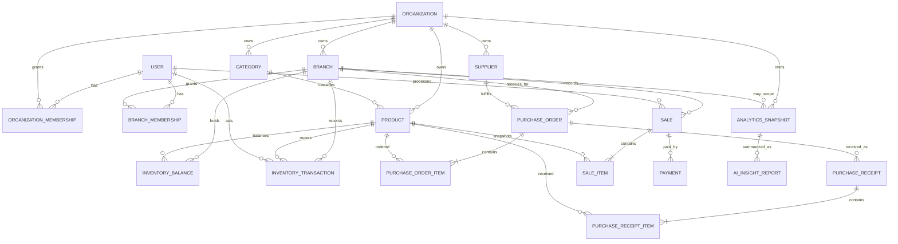

# StockWise Database Contract

| Field | Value |
| --- | --- |
| Status | Architecture Freeze v1 logical data contract; no Prisma schema or migration exists yet |
| Database | PostgreSQL |
| ORM/migrations | Prisma |
| Baseline | Architecture Freeze v1 |
| Last updated | 2026-08-22 |

## 1. Scope and authority

This document is the Source of Truth for StockWise's logical entities, ownership, relationships, constraints, indexes, lifecycle rules, and transaction invariants. It does not choose physical identifier types, quantity precision, or unresolved business states.

Metric formulas belong to `docs/ANALYTICS.md`. HTTP payloads belong to `docs/API.md`. Product questions are tracked only in the master Open Questions register in `BUILD_SPEC.md`.

## 2. Database-wide invariants

1. PostgreSQL is the only primary system of record.
2. `Organization` is the tenant boundary.
3. Every business record must carry or unambiguously derive organization ownership.
4. Branch-owned records must reference a branch and only organization-owned resources from that branch's organization.
5. Tenant and branch authorization is enforced in application policy and scoped persistence queries; foreign keys and constraints provide defense in depth.
6. Money and costs use PostgreSQL `NUMERIC`/`DECIMAL` and Prisma `Decimal`, never unconstrained binary floating point.
7. Timestamps are stored in UTC. Reporting timezone semantics remain `OQ-016`.
8. Stock truth consists of an append-oriented ledger plus a transactionally consistent current-balance projection.
9. Checkout, receiving, adjustment, and reversal changes are atomic.
10. Historical sale and receipt line snapshots do not change when current catalog data changes.
11. Retried creates and scheduled jobs use stable idempotency keys/uniqueness constraints.
12. Application validation never substitutes for database constraints.
13. No hard deletion of completed operational history or inventory ledger entries is allowed.

## 3. Conceptual relationship model

The diagram is logical. It does not authorize optional features such as transfers or refunds.

## 4. Entity contracts

Fields are logical attributes. Exact Prisma names, mapped SQL names, ID types, enum representations, and nullability must be finalized in the schema task without changing the business meaning.

### 4.1 Identity and tenancy

#### `User`

Purpose: one platform identity that may access multiple organizations/branches.

Required logical attributes:

- Stable identifier
- Normalized email
- Argon2 password hash for MVP email/password identity
- Account status
- Profile attributes accepted by `OQ-005`
- Created/updated timestamps
- Credential/security timestamps needed by `OQ-003` and `OQ-004`

Constraints and indexes:

- Email is globally unique after documented normalization.
- Password hash is never selected into general user DTOs, logs, analytics, or AI data.
- Index account status only if a proven query requires it.

Lifecycle:

- Registration creates an account according to verification/onboarding decisions.
- Deactivation must preserve historical actor references.
- Physical deletion/anonymization and retention require an accepted policy.

#### `Organization`

Purpose: tenant and business ownership boundary.

Required logical attributes:

- Stable identifier
- Display name
- Organization status
- Reporting timezone/config after `OQ-016`
- Created/updated timestamps

Constraints and indexes:

- Organization names are not assumed globally unique.
- A unique human slug/code is not required unless accepted later.

Lifecycle:

- Created through the finalized onboarding flow.
- Suspension/deactivation must deny new operational writes while preserving history.
- Deletion and retention are unresolved and must not become cascade deletion of operational history.

#### `OrganizationMembership`

Purpose: links a user to an organization-wide role/scope.

Required logical attributes:

- Organization identifier
- User identifier
- Organization-scoped role
- Membership status
- Invitation/acceptance metadata after `OQ-006`
- Created/updated timestamps

Constraints and indexes:

- Unique `(organization, user)` active membership identity.
- Index by user for accessible-organization lookup.
- Index by organization for member administration.
- Role names use the accepted MVP baseline: `OWNER`, `ADMIN`, `BRANCH_MANAGER`, `INVENTORY_STAFF`, and `CASHIER`. Their exact organization-level use, delegation, and permissions remain governed by `OQ-022`.

#### `Branch`

Purpose: operational scope within an organization.

Required logical attributes:

- Organization identifier
- Stable identifier
- Branch code
- Display name
- Contact/address fields accepted for onboarding/branch management
- Branch status
- Created/updated timestamps

Constraints and indexes:

- Unique `(organization, branch code)`.
- Branch organization ownership is immutable after operational records exist.
- A branch cannot reference another organization.

#### `BranchMembership`

Purpose: grants one user an explicit role at one branch.

Required logical attributes:

- Branch identifier
- User identifier
- Branch-scoped role
- Membership status
- Created/updated timestamps

Constraints and indexes:

- Unique `(branch, user)` active membership identity unless `OQ-022` accepts multiple simultaneous roles.
- Index by user for branch switching.
- Index by branch for administration.
- The user must also have the required relationship to the branch's organization according to the accepted membership model.
- Branch role names come from the accepted MVP baseline; exact permission semantics and whether multiple simultaneous roles are allowed remain governed by `OQ-022`.

### 4.2 Catalog

#### `Category`

Purpose: organization-level product classification.

Required logical attributes:

- Organization identifier
- Stable identifier
- Name
- Optional description
- Status
- Created/updated timestamps

Constraints and indexes:

- Category belongs to exactly one organization.
- Organization-scoped name normalization/uniqueness follows `OQ-024`; do not assume global uniqueness.
- Products may keep a nullable category reference if uncategorized products are accepted.

#### `Product`

Purpose: organization-level catalog item referenced by all branch operations.

Required logical attributes:

- Organization identifier
- Stable identifier
- Optional category identifier from the same organization
- SKU
- Optional barcode
- Name
- Optional description/brand
- Unit of measure
- Current organization selling price unless `OQ-014` accepts overrides
- Cost-related attributes required by the accepted `OQ-010` model
- Optional low-stock/reorder configuration after analytics definitions are accepted
- Status
- Created/updated timestamps

Constraints and indexes:

- Unique `(organization, normalized SKU)`.
- Unique `(organization, normalized barcode)` when barcode is present.
- Category, if present, must belong to the same organization.
- Index `(organization, status, name)` or a more suitable search index based on measured search behavior.
- Product status changes must not rewrite historical sale, purchase, receipt, or ledger records.

Lifecycle:

- Prefer deactivation over deletion once referenced.
- Price/cost changes affect future operations only.
- Branch price overrides are not represented unless `OQ-014` is accepted.

#### `Supplier`

Purpose: organization-level purchasing counterparty.

Required logical attributes:

- Organization identifier
- Stable identifier
- Name
- Contact details appropriate to the accepted product scope
- Optional default lead time when forecasting/reorder definitions require it
- Status
- Created/updated timestamps

Constraints and indexes:

- Supplier belongs to one organization.
- Supplier normalization/duplicate behavior follows `OQ-024`; names are not assumed globally unique.
- Deactivation/deletion behavior follows `OQ-024` and must preserve purchase history.

### 4.3 Inventory

#### `InventoryBalance`

Purpose: query-efficient current quantity for one product at one branch.

Required logical attributes:

- Branch identifier
- Product identifier
- Current quantity using the precision accepted by `OQ-023`
- Concurrency/version metadata if the chosen locking strategy requires it
- Updated timestamp

Constraints and indexes:

- Unique `(branch, product)`.
- Product and branch must belong to the same organization.
- Quantity constraints follow `OQ-007`; the schema must not assume non-negative values before that decision.
- Read/update access is normally keyed by `(branch, product)`.

Invariant:

`InventoryBalance.quantity` must equal the accepted ledger projection for the same branch/product, accounting for any explicitly documented opening/import checkpoint. Reconciliation must detect divergence.

#### `InventoryTransaction`

Purpose: append-oriented explanation of every stock change.

Required logical attributes:

- Stable identifier
- Branch identifier
- Product identifier
- Movement type
- Signed quantity delta using `OQ-023` precision
- Reason/source type and source identifier
- Acting user or system actor
- Optional note/reason code for adjustments
- Occurred/created timestamp
- Idempotency/source uniqueness metadata

Accepted movement concepts:

- Purchase receipt: positive
- Sale: negative
- Approved adjustment: signed
- Refund/void compensation: only after `OQ-009`
- Transfer out/in: only after `OQ-013`

Constraints and indexes:

- Quantity delta cannot be zero.
- Branch and product must share organization ownership.
- One source line cannot produce the same movement twice.
- Index `(branch, product, occurredAt, id)` for history and reconciliation.
- Index source reference for traceability/idempotency.
- Ledger rows are not edited or deleted to correct mistakes; create an authorized compensating transaction.

### 4.4 Purchasing and receiving

#### `PurchaseOrder`

Purpose: records an order from an organization supplier for delivery to one branch.

Required logical attributes:

- Organization and target branch identifiers
- Supplier identifier
- Stable identifier and human-facing order number after numbering rules are accepted
- Lifecycle status accepted through `OQ-021`
- Order date and optional expected date
- Currency if multi-currency is ever accepted; current scope should not imply multi-currency
- Aggregate amounts stored/recomputed according to the accepted contract
- Creator and relevant actor timestamps
- Created/updated timestamps

Constraints and indexes:

- Branch and supplier must belong to the order's organization.
- Human number, if used, is unique within its accepted scope.
- Index `(organization, branch, status, orderDate)`.
- A received order cannot be silently edited into a different historical order.

#### `PurchaseOrderItem`

Purpose: requested product and commercial snapshot within a purchase order.

Required logical attributes:

- Purchase order identifier
- Product identifier from the same organization
- Product/SKU/name snapshots needed for historical readability
- Ordered quantity
- Expected unit cost as Prisma `Decimal`
- Discount/tax/line total only if accepted by `OQ-010`/`OQ-021`
- Created/updated timestamps

Constraints:

- Positive quantity.
- Product organization equals purchase-order organization.
- Duplicate product-line behavior must be deliberately selected; do not rely on accidental duplicates.

#### `PurchaseReceipt`

Purpose: immutable record of a receiving event against one purchase order and branch.

Required logical attributes:

- Purchase order and branch identifiers
- Stable receipt identifier/number
- Receipt status
- Received-at time and receiving actor
- Idempotency key/source metadata
- Created/updated timestamps

Constraints and indexes:

- Receipt branch equals purchase-order branch.
- Idempotency key is unique in the accepted organization/branch scope.
- A completed receipt is not edited; corrections use an accepted reversal/return flow.
- Partial/over-receipt and cancellation rules are blocked by `OQ-021`.

#### `PurchaseReceiptItem`

Purpose: received quantity and actual-cost snapshot for one product in a receipt.

Required logical attributes:

- Receipt and purchase-order-item identifiers
- Product identifier
- Product/SKU/name snapshots
- Received quantity
- Actual unit cost as Prisma `Decimal`
- Created timestamp

Constraints:

- Positive quantity.
- Product/order/receipt organizations and branches agree.
- A completed receipt item maps uniquely to its inventory movement(s).

### 4.5 Sales and payment

#### `Sale`

Purpose: branch-scoped completed checkout and lifecycle root.

Required logical attributes:

- Organization and branch identifiers
- Stable identifier and human-facing receipt number after `OQ-008`
- Acting cashier/user identifier
- Sale status
- Currency context if later required
- Trusted subtotal, discount, tax, and total as Prisma `Decimal` according to `OQ-008`
- Business occurred-at and created/updated timestamps
- Idempotency key
- Reversal linkage/status after `OQ-009`

Constraints and indexes:

- Branch belongs to organization.
- Actor is authorized at that branch at checkout time.
- Unique idempotency key in an accepted branch/organization scope.
- Human receipt number is unique in the accepted numbering scope.
- Index `(organization, branch, occurredAt, id)` for history and analytics.
- Index actor and status only for proven use cases.

Lifecycle:

- Core MVP supports an atomically completed sale.
- Void/refund/partial refund transitions are not defined until `OQ-009`.
- Completed sales are historical records and are not hard-deleted or rewritten.

#### `SaleItem`

Purpose: immutable line-level sale facts independent of future catalog changes.

Required logical attributes:

- Sale identifier
- Product identifier
- Product name, SKU, and barcode snapshots as applicable
- Quantity using `OQ-023` precision
- Unit price and unit cost snapshot as Prisma `Decimal`
- Discount/tax allocation and line totals according to `OQ-008`
- Created timestamp

Constraints:

- Positive quantity for a normal sale line.
- Product belongs to sale organization.
- Stored totals satisfy the accepted monetary rounding/allocation rules.
- Completed line snapshots are immutable; reversal uses linked compensating records.

#### `Payment`

Purpose: records payment information associated with a sale.

Required logical attributes:

- Sale identifier
- Payment method and status after `OQ-008`
- Amount as Prisma `Decimal`
- Provider/reference data if an accepted method requires it
- Created/updated timestamps
- Reversal/refund linkage after `OQ-009`

Constraints:

- Payment totals and sale status satisfy the accepted payment rules.
- Sensitive payment credentials/card data are never stored directly.
- Split/multiple payment is not implied until `OQ-008` accepts it.

### 4.6 Analytics and AI

#### `AnalyticsSnapshot`

Purpose: versioned, reproducible aggregate facts for a report scope and period.

Required logical attributes:

- Organization identifier
- Optional branch identifier; null indicates an authorized organization aggregate by explicit convention
- Period type: daily, weekly, monthly, or yearly
- Canonical period start/end in UTC plus reporting timezone identifier
- Metric-definition version
- Snapshot schema version
- Structured aggregate values
- Data completeness/status
- Source cutoff/watermark
- Created timestamp

Constraints and indexes:

- Branch, if present, belongs to organization.
- Unique `(organization, branch scope, period type, period start, metric version)` or an equivalent normalized scope key.
- Snapshot payload must validate against the versioned schema in `docs/ANALYTICS.md`.
- Snapshot contains aggregates only; no individual customer/employee personal data or raw transaction lines.

Lifecycle:

- A snapshot may be recomputed only under a documented version/revision policy.
- Historical snapshots retain the definition/schema version used.

#### `AIInsightReport`

Purpose: persisted OpenRouter summary derived from one analytics snapshot.

Required logical attributes:

- Analytics snapshot identifier
- Organization/branch scope duplicated or derived safely for access control
- Cadence and period
- Prompt/template version
- Provider and model identifier
- Status
- Generated natural-language content on success
- Failure category and safe retry metadata on failure
- Input/output usage and cost metadata when safely available
- Attempted/generated/created timestamps

Constraints and indexes:

- Unique successful/current report for the accepted `(snapshot, prompt version, locale)` identity.
- Provider request identity supports idempotency/retry control.
- Content cannot become a source of numerical truth; the linked snapshot remains authoritative.
- No raw prompt containing secrets or prohibited data is stored.

### 4.7 Operational support records

The implementation may require records such as idempotency claims, job leases, or audit events. They are permitted implementation details only when they preserve these rules:

- Idempotency records are scoped so one tenant cannot collide with or discover another tenant's key.
- Job claims prevent duplicate report generation and expire/recover safely.
- Audit scope is governed by `OQ-019`.
- Support records never replace domain constraints or transactional uniqueness.

## 5. Cross-tenant constraint strategy

Simple foreign keys alone may allow mismatched organization references when a branch-owned table points to both a branch and an organization-owned entity. Each schema design must demonstrate how it prevents or detects this.

Acceptable techniques include:

- Composite keys/foreign keys including `organizationId`
- Database constraints/triggers where Prisma cannot express the invariant safely
- Transactional ownership validation plus scoped unique references, backed by tests

The chosen physical approach is an implementation detail, but the invariant is mandatory. Every read and write query must still include trusted organization/branch scope.

## 6. Transaction contracts

### 6.1 Checkout

One database transaction must:

1. Claim/check the idempotency key.
2. Load and lock or otherwise concurrency-protect required inventory balances.
3. Re-read accepted product/price data and verify branch/organization ownership.
4. Enforce `OQ-007` stock policy and `OQ-008` payment/totals rules.
5. Create the sale and immutable sale items.
6. Create payment record(s).
7. Append one inventory transaction per stock movement.
8. Update each inventory balance consistently.
9. Commit all records or roll back all records.

### 6.2 Purchase receiving

One database transaction must:

1. Claim/check the idempotency key.
2. Load the purchase order and protect its receive state from concurrent writes.
3. Enforce `OQ-021` quantity/lifecycle rules.
4. Create receipt and immutable receipt-line snapshots.
5. Append purchase-receive inventory transactions.
6. Update balances.
7. Apply costing changes from `OQ-010`.
8. Update purchase-order state.
9. Commit all records or roll back all records.

### 6.3 Adjustment

One database transaction must validate permission/reason, append the signed adjustment movement, update the balance under the accepted negative-stock rule, and preserve the actor/context. Never overwrite the balance as an untraceable correction.

### 6.4 Refund/void and transfer

No transaction contract is accepted yet. They are blocked by `OQ-009` and `OQ-013`; do not infer a design from example ledger movement names.

## 7. Concurrency strategy requirements

The implementation may choose row locking, conditional/versioned updates, atomic SQL updates with affected-row checks, or another PostgreSQL-safe method. It must prove through integration tests that:

- Concurrent checkout cannot lose an inventory update.
- Negative stock behavior matches `OQ-007` exactly.
- Duplicate idempotency keys return/recover one logical result.
- Concurrent receiving cannot exceed accepted quantities or double-count stock.
- Lock order is deterministic across multiple cart lines to reduce deadlock risk.
- A deadlock/serialization failure is handled with a bounded safe retry only where the whole operation is idempotent.

## 8. Money, quantity, and rounding

- Money and costs use `Decimal` through validation, calculation, persistence, and serialization.
- The API must define a canonical decimal string representation; it must not silently convert precise values to JavaScript floating point.
- Currency, rounding scale/mode, tax allocation, discounts, and cash rounding are governed by `OQ-008` and `OQ-010`.
- Quantity representation and fractional units are governed by `OQ-023`.
- All stored aggregate totals must be reproducible from accepted line-level snapshots and rounding rules.

## 9. Index plan by access pattern

Indexes must be validated against actual queries and PostgreSQL plans; do not add every possible index.

| Access pattern | Required leading scope |
| --- | --- |
| User organizations/branches | `userId`, membership status |
| Organization members | `organizationId`, status/role as needed |
| Branch members | `branchId`, status/role as needed |
| Product management/search | `organizationId` plus status/SKU/barcode/name strategy |
| Current stock lookup | unique `branchId, productId` |
| Inventory history | `branchId, productId, occurredAt, id` |
| Purchase list | `organizationId, branchId, status/date` |
| Sale history | `organizationId, branchId, occurredAt, id` |
| Analytics aggregation | branch/organization and occurred-at fields on accepted completed facts |
| Scheduled snapshots | scope key, period type/start, definition version |
| AI report lookup | organization/branch scope, cadence/period, status |

Every unique constraint required for correctness is mandatory even if no direct UI query uses it.

## 10. Data lifecycle and deletion

- Master data (`Product`, `Category`, `Supplier`, `Branch`, memberships) should normally be deactivated when referenced by history.
- Completed `Sale`, `SaleItem`, `Payment`, `PurchaseReceipt`, `PurchaseReceiptItem`, and `InventoryTransaction` records are not hard-deleted or mutated to hide corrections.
- Corrections use explicit status transitions and/or compensating records after the corresponding rules are accepted.
- User/organization deletion, anonymization, legal retention, analytics snapshot retention, and AI output retention require a policy before production (`OQ-020` and related security decisions).
- Cascade deletion must never erase business history accidentally.

## 11. Migration rules

- Prisma schema changes require a reviewed forward migration.
- Inspect generated SQL before execution.
- Never modify applied migration history to disguise a change.
- Destructive or backfill-heavy changes need a staged migration and recovery plan.
- Required columns on existing data need a safe populate-then-constrain sequence.
- Unique constraints need duplicate-data analysis before application.
- Production migration execution is a separately authorized operation.
- A model affected by a blocking Open Question must not be migrated until the decision is accepted.

## 12. Database validation matrix

At minimum, database-backed tests must cover:

- Same email, SKU, barcode, membership, balance, idempotency, or report identity duplicates
- Product/category/supplier from another organization
- Branch resource accessed or linked from another organization
- Missing/disabled membership and unauthorized branch
- Atomic checkout success and rollback at each failure point
- Concurrent checkout and balance consistency
- Atomic receiving success and rollback at each failure point
- Concurrent/duplicate receiving
- Adjustment traceability
- Ledger-to-balance reconciliation
- Historical snapshot immutability after product changes
- Decimal precision and accepted rounding
- Daily/monthly/yearly timezone and boundary fixtures after `OQ-016`

## 13. Blocking Open Questions

The canonical definitions live in `BUILD_SPEC.md`:

- `OQ-003` authentication state storage/revocation affects credential/session records.
- `OQ-004` verification/reset affects identity state.
- `OQ-005` onboarding fields affect user/organization/branch columns.
- `OQ-006` invitation flow affects membership state.
- `OQ-007` negative stock affects balance constraints.
- `OQ-008` payment, tax, discount, and numbering affect sales/payment fields.
- `OQ-009` reversal rules affect lifecycle/linkage.
- `OQ-010` costing affects product/receipt/sale cost data.
- `OQ-011` completed-sale and metric definitions affect indexes/snapshots.
- `OQ-012` forecast definition affects forecast storage.
- `OQ-013` transfer lifecycle affects inventory records.
- `OQ-014` price override affects catalog/branch relationships.
- `OQ-016` timezone affects period/schedule fields.
- `OQ-017` schedule affects job identity.
- `OQ-018` provider/fallback/retention affects AI report fields.
- `OQ-019` audit scope affects operational support records.
- `OQ-020` retention/recovery targets affect lifecycle.
- `OQ-021` receiving behavior affects purchase state and quantities.
- `OQ-022` permissions affect role representation.
- `OQ-023` quantity units and precision affect every stock/sale/purchase quantity.
- `OQ-024` catalog/supplier normalization and lifecycle affect master-data constraints.
