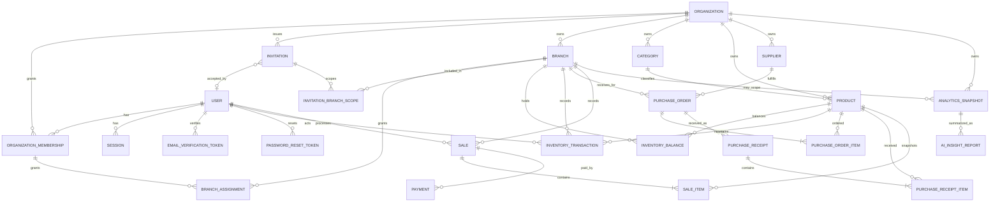

# StockWise Database Contract

| Field | Value |
| --- | --- |
| Status | Architecture Freeze v1 logical data contract; P2 identity/tenancy schema implemented |
| Database | PostgreSQL |
| ORM/migrations | Prisma |
| Baseline | Architecture Freeze v1 |
| Last updated | 2026-08-25 |

## 1. Scope and authority

This document is the Source of Truth for StockWise's logical entities, ownership, relationships, constraints, indexes, lifecycle rules, and transaction invariants. It does not choose physical identifier types, quantity precision, or unresolved business states.

Metric formulas belong to `docs/ANALYTICS.md`. HTTP payloads belong to `docs/API.md`. Product questions are tracked only in the master Open Questions register in `BUILD_SPEC.md`.

### Prisma foundation

`apps/api` owns Prisma configuration at `apps/api/prisma.config.ts`, the
PostgreSQL schema at `apps/api/prisma/schema.prisma`, reviewed migrations at
`apps/api/prisma/migrations/`, and the ignored generated client at
`apps/api/src/generated/prisma/`. P1-M3-T02 established the empty foundation;
P2-M1-T02 adds only the accepted identity and tenancy models, their initial
forward migration, and the later nullable-display-name correction migration.

The API validates its required server-only `DATABASE_URL` before runtime use.
Prisma CLI generation and schema validation work without a populated local URL;
commands that access PostgreSQL, including future migrations, require that URL.
Generated clients are regenerated locally and in quality commands, while
migrations remain reviewable source files. P2-M1-T02 selects UUID primary keys,
`snake_case` PostgreSQL table/column/constraint names through Prisma mappings,
and millisecond-precision `TIMESTAMPTZ` UTC instants. Later model tasks must
continue those physical conventions unless an accepted migration changes them.

### Database test harness

P1-M3-T03 adds API-owned test support under `apps/api/src/test/` without adding
a Prisma model, business table, or migration. Database tests use the separate,
server-only `TEST_DATABASE_URL`, never the API runtime `DATABASE_URL`. The test
URL must be PostgreSQL, loopback-only, name a database ending in `_test`, and
differ from `DATABASE_URL`; the harness validates those rules before it creates
or resets anything. The local test role creates the disposable target database
through its local `postgres` database when necessary.

Each Vitest run provisions the target, applies committed migrations with
`prisma migrate deploy`, then clears public-schema table data with
`TRUNCATE ... RESTART IDENTITY CASCADE` while preserving Prisma migration
metadata and removes only the harness-owned `stockwise_test_harness` scratch
schema. It repeats that cleanup during teardown. Test files run serially because
they intentionally share one resettable target.

Run `pnpm test` for the full suite or `pnpm test:db` for the focused harness.
Both require a populated local `TEST_DATABASE_URL`; CI supplies an ephemeral
PostgreSQL service and a test-only URL.

### Implemented identity and tenancy schema

P2-M1-T02 creates exactly these PostgreSQL-backed Prisma models. The forward
`20260824120921_make_user_display_name_nullable` correction makes only
`User.displayName` nullable so registration can persist before profile/onboarding:

- `User`, `Organization`, `OrganizationMembership`, `Branch`, and
  `BranchAssignment`
- `Session`, `EmailVerificationToken`, and `PasswordResetToken`
- `Invitation` and `InvitationBranchScope`
- `MembershipAccessEvent` and `MembershipAccessEventBranchScope` (bounded
  P2-M3-T03 access-lifecycle provenance only)

The forward `20260824210000_membership_access_provenance` migration adds a
stable membership resource ID while retaining the existing
`(organizationId,userId)` primary identity, tenant-safe invitation
issuer/revoker and membership-source references, terminal revocation reasons,
and immutable access-event/scope-snapshot tables. It fails closed if manually
inserted pre-T03 invitations exist because a trustworthy issuer cannot be
fabricated.

Email identity is stored canonically as surrounding-whitespace-trimmed,
lowercase text. The API implementation must perform that normalization before
persistence; PostgreSQL rejects a non-canonical stored value and uniquely
indexes the canonical `User.email`. `Invitation.invitedEmail` uses the same
stored representation. Password and opaque-token columns store only hashes;
there is no plaintext session, verification, reset, or invitation-token column.

Statuses are deliberately limited to the accepted lifecycle boundary:
`ACTIVE`/`DISABLED` for users and `ACTIVE`/`INACTIVE` for organizations,
memberships, branches, and branch assignments. A matching deactivation
timestamp is required for every inactive/disabled row. The schema adds no
generic audit log, organization timezone, auth endpoint, provider, or
later-domain field; `MembershipAccessEvent` is deliberately limited to the T03
access transitions while `OQ-019` remains open.

The initial migration adds SQL checks and partial unique indexes that Prisma cannot
express. They validate nonblank normalized identity/hash/name fields, lifecycle
status/timestamp agreement, session expiry ordering, one-time-token state and
expiry ordering, one open verification token per user, and one open invitation
per organization/email. Expired open records must be marked revoked or replaced
in the same transaction that creates their replacement.

The display-name nonblank check remains in force when a value is present;
PostgreSQL permits `NULL` through that check. The forward correction drops only
the column's `NOT NULL` requirement, performs no table rewrite/backfill, and
does not alter the initial migration. Reintroducing `NOT NULL` requires a later
reviewed backfill and forward migration after all applicable accounts have a
profile.

## 2. Database-wide invariants

1. PostgreSQL is the only primary system of record.
2. `Organization` is the tenant boundary.
3. Every business record must carry or unambiguously derive organization ownership.
4. Branch-owned records must reference a branch and only organization-owned resources from that branch's organization.
5. Tenant and branch authorization is enforced in application policy and scoped persistence queries; foreign keys and constraints provide defense in depth.
6. Money and costs use PostgreSQL `NUMERIC`/`DECIMAL` and Prisma `Decimal`, never unconstrained binary floating point.
7. Timestamps are stored in UTC. Reporting timezone semantics remain `OQ-016`.
8. Stock truth consists of an append-oriented ledger plus a transactionally consistent current-balance projection.
9. Checkout, receiving, adjustment, and reversal changes are atomic. Every accepted
   stock-decreasing movement rejects a resulting negative quantity inside its
   authoritative balance transaction; no override exists.
10. Historical sale and receipt line snapshots do not change when current catalog data changes.
11. Retried creates and scheduled jobs use stable idempotency keys/uniqueness constraints.
12. Application validation never substitutes for database constraints.
13. No hard deletion of completed operational history or inventory ledger entries is allowed.
14. Browser sessions and one-time identity tokens persist only cryptographic token hashes; raw session, verification, reset, and invitation tokens are never stored.
15. Every organization has at least one active `OWNER`; one organization role belongs to each user/organization membership, while branch access for branch-only roles is represented by assignments.
16. Future purchase receiving uses THB only, exact Decimal values, `ROUND_HALF_UP` at an accepted persisted/display scale, and one atomic receipt/ledger/balance/cost/PO transition according to `ADR-026`.

## 3. Conceptual relationship model



The diagram is logical. It does not authorize optional features such as transfers or refunds.

## 4. Entity contracts

Fields are logical attributes. Exact Prisma names, mapped SQL names, ID types, enum representations, and nullability must be finalized in the schema task without changing the business meaning.

### 4.1 Identity and tenancy

#### `User`

Purpose: one platform identity that may access multiple organizations/branches.

Required logical attributes:

- Stable identifier
- Normalized email
- Argon2 password hash for MVP email/password identity
- Account status
- Display name, nullable until the later required profile/onboarding flow, and optional phone
- Created/updated timestamps
- Credential/security timestamps needed for verification, reset, session revocation, and account deauthorization

Constraints and indexes:

- Email is globally unique after documented normalization.
- A non-null display name must contain non-whitespace content; registration must
  not synthesize a placeholder from the email.
- Password hash is never selected into general user DTOs, logs, analytics, or AI data.
- Index account status only if a proven query requires it.

Lifecycle:

- Registration creates an email/password account with `displayName` and
  `emailVerifiedAt` set to `NULL`; it creates no verification-token record.
- P2-M2-T03 owns verification-token creation, resend, provider delivery, and
  verification. Profile/onboarding later supplies the required display name.
- Deactivation must preserve historical actor references.
- Physical deletion/anonymization and retention require an accepted policy.

#### `Organization`

Purpose: tenant and business ownership boundary.

Required logical attributes:

- Stable identifier
- Display name
- Organization status
- Reporting timezone/config after `OQ-016`
- Created/updated timestamps

Constraints and indexes:

- Organization names are not assumed globally unique.
- A unique human slug/code is not required unless accepted later.

Lifecycle:

- Created through the accepted onboarding flow.
- Suspension/deactivation must deny new operational writes while preserving history.
- Deletion and retention are unresolved and must not become cascade deletion of operational history.

#### `OrganizationMembership`

Purpose: links a user to an organization-wide role/scope.

Required logical attributes:

- Organization identifier
- Stable membership resource identifier
- User identifier
- Organization-scoped role
- Membership status
- One organization role: `OWNER`, `ADMIN`, `BRANCH_MANAGER`, `INVENTORY_STAFF`, or `CASHIER`
- Active/inactive lifecycle and nullable unique source-invitation provenance
- Created/updated timestamps

Constraints and indexes:

- Unique `(organization, user)` membership identity across all statuses.
- Unique `(organization, stable membership ID)` and at most one membership per
  source invitation; the source invitation must carry the same organization.
- Index by user for accessible-organization lookup.
- Index by organization for member administration.
- Exactly one organization role applies to a user within an organization. `OWNER`/`ADMIN` are organization-wide; `BRANCH_MANAGER`, `INVENTORY_STAFF`, and `CASHIER` additionally require branch assignments. The application transaction/policy layer preserves at least one active `OWNER` and prevents unauthorized role delegation.

#### `Branch`

Purpose: operational scope within an organization.

Required logical attributes:

- Organization identifier
- Stable identifier
- Branch code
- Display name
- Required display name; optional phone and address
- Branch status
- Created/updated timestamps

Constraints and indexes:

- Unique `(organization, branch code)`.
- Post-onboarding branch code and organization ownership are immutable.
- Codes are canonical uppercase ASCII, 1–16 characters, match
  `[A-Z0-9][A-Z0-9_-]*`, and are unique only within their organization. `MAIN`
  is not globally reserved.
- A branch cannot reference another organization.
- Branches use only `ACTIVE`/`INACTIVE`; deactivation sets `deactivatedAt`,
  reactivation clears it, and no branch-management delete exists.
- A lifecycle transaction locks the organization row and refuses to deactivate
  its last active branch. The lock serializes competing deactivations.
- Branch edits and lifecycle changes compare the exact prior millisecond UTC
  `updatedAt`; a mismatch is a stale-write conflict. A same-state lifecycle
  request with the matching version is idempotent and does not advance the row.
- Branch assignments are preserved when a branch becomes inactive. They become
  ineffective while inactive and effective again after reactivation if the
  assignment and membership remain active.

#### `BranchAssignment`

Purpose: grants a user with a branch-only organization role access to one explicit branch.

Required logical attributes:

- Branch identifier
- User identifier
- Membership status
- Created/updated timestamps

Constraints and indexes:

- Unique `(branch, user)` active assignment identity.
- Index by user for branch switching.
- Index by branch for administration.
- The user's active organization membership must belong to the branch's organization and have a branch-only role. `OWNER`/`ADMIN` do not need assignments for branch access.

#### `FirstOrganizationOnboarding`

Purpose: durable one-time provenance and replay identity for the platform user's
first organization flow.

Required physical attributes and invariants:

- `userId` is the primary key, so exactly one provenance row may exist per user.
- `organizationId` is unique; `(organizationId, userId)` restrictively references
  the exact membership created by onboarding, proving that the recorded user and
  organization belong to the same membership identity.
- `(branchId, organizationId)` is unique and restrictively references the existing
  composite branch identity, proving that the recorded initial branch belongs to
  the recorded organization.
- `requestHash` is exactly one lowercase 64-hex-character SHA-256 value derived
  internally from the canonical six-field request; it is not an API credential or
  response field.
- `completedAt` is a UTC completion timestamp.
- Membership and branch update/delete actions are `RESTRICT`; their existing
  foreign keys continue to protect the user and organization. Replay
  reconstructs safe current resource data rather than storing an HTTP response blob.

The row does not replace membership authorization. The same transaction creates
the user's `OWNER` membership for its recorded organization, while organization-
wide OWNER access deliberately creates no `BranchAssignment`.

#### `Session`

Purpose: server-side browser-authentication state for one user session.

Required logical attributes:

- User identifier
- Cryptographic hash of the opaque session token, unique for lookup
- Issued, last-used, idle-expiry, and absolute-expiry timestamps
- Revoked timestamp/reason where applicable
- Created/updated timestamps

Constraints and lifecycle:

- The raw token is never persisted. A session is valid only while unrevoked, its user is enabled/authorized, and neither expiry has passed.
- Successful authentication creates a fresh session. If the incoming `stockwise_session` cookie identifies a currently valid session for the same user, revoking it as `login_rotation` and creating the fresh record is one transaction. Unknown, malformed, revoked, or expired incoming tokens are not reused.
- Initial idle expiry is issue time plus the configurable 24-hour baseline; absolute expiry is issue time plus the configurable seven-day baseline. Absolute expiry is immutable. After a valid authenticated request, activity is persisted at most once per 15 minutes: `lastUsedAt` becomes the touch time and idle expiry becomes `min(touch + idle timeout, absolute expiry)`. A required touch failure fails authentication closed, and an expired session is never revived.
- Logout conditionally revokes the current hash-identified open session as
  `logout`; authenticated all-session logout revokes every open session for the
  actor as `logout_all`. Password reset revokes every open session for the user
  as `password_reset` in the password/token transaction. Repeated current
  logout is idempotent and no user-wide mutation may affect another user.
- Index active-session lookup by token hash and user-wide revocation/query paths by user and expiry/revocation state.

#### `EmailVerificationToken` and `PasswordResetToken`

Purpose: single-use proof for email verification and password recovery.

Required logical attributes:

- User identifier
- Cryptographic token hash, unique for lookup
- Issued, expiry, consumed, and replacement/revocation timestamps
- Created/updated timestamps

Constraints and lifecycle:

- Raw tokens are never persisted. Verification tokens expire after 24 hours; reset tokens expire after 30 minutes.
- Each token is single-use. Resending verification replaces and invalidates the prior active verification token. A successful reset revokes all sessions.
- P2-M2-T03 generates 32 random bytes and persists only SHA-256. Verification
  and reset issuance lock the owning user row before replacing every open token
  and inserting the fresh record, which serializes concurrent replacement.
  Provider failure conditionally marks only the just-issued still-open token
  revoked; a later replacement is never overwritten by compensation.
- Verification completion conditionally consumes the open, unexpired token and
  sets the active user's `emailVerifiedAt` in one transaction. Password reset
  performs a read-only validity check before Argon2, then conditionally consumes
  the still-valid token, updates `passwordHash`/`passwordChangedAt`, and revokes
  all open sessions in one transaction. Any failed write rolls the entire reset
  transaction back; no new session is created.

#### `Invitation`

Purpose: email-bound, organization-scoped invitation that records the intended membership role and branch scope before acceptance.

Required logical attributes:

- Organization identifier, normalized invited email, intended organization role, and intended branch assignments
- Cryptographic invitation-token hash, unique for lookup
- Issued, expiry, consumed, revoked/replaced, and accepted-by-user timestamps
- Same-organization issuer membership; nullable same-organization revoker
  membership and explicit terminal reason
- Created/updated timestamps

Constraints and lifecycle:

- Raw tokens are never persisted. Invitations are single-use, expire after seven days, and reissue/replacement invalidates the prior active invitation.
- Acceptance requires authentication and verified ownership of the invited email. The membership and branch assignments are created atomically and idempotently.
- A changed intended role or branch scope revokes the old invitation and creates a replacement; no automatic account creation or cross-email linking occurs.
- Delivery failure conditionally records `DELIVERY_FAILED`; management revoke
  records `CANCELLED`; reissue records `REPLACED`. A concurrent pre-existing
  membership winner records the bounded `MEMBERSHIP_EXISTS` terminal reason.

#### `MembershipAccessEvent`

Purpose: immutable, task-scoped provenance for invitation acceptance and
membership effective-access transitions. It is not the generic audit mechanism
left open by `OQ-019`.

Each row stores the same-organization target membership, global actor user,
nullable same-organization actor membership, event type, before/after
role/status, and UTC occurrence time. A separate immutable scope table snapshots
the resulting configured branch IDs for branch-scoped access. Composite foreign
keys prove that target, actor membership, event, and every snapshotted branch
belong to the recorded organization. Restrictive foreign keys preserve
relationships, and table-specific triggers reject event/snapshot update or
delete operations. Test-harness `TRUNCATE` remains available only behind the
guarded disposable-database boundary.

### 4.2 Catalog

#### `Category`

Purpose: organization-level product classification.

Required logical attributes:

- Organization identifier
- Stable identifier
- Trimmed display name and internal normalized identity key
- Optional description
- Status
- Created/updated timestamps

Constraints and indexes:

- Category belongs to exactly one organization.
- Category is flat; no parent/hierarchy or merge exists in MVP.
- The NFKC/trim/collapsed-Unicode-whitespace/lowercase normalized identity key is unique per organization; the trimmed display name preserves presentation and need not be lowercase.
- Products may keep a nullable category reference; uncategorized products are accepted.
- An inactive category remains referenced but cannot receive a new product assignment. Category mutations use exact `updatedAt` optimistic concurrency.

P3-M1-T02 persists this contract in `categories` with UUID `id` and
`organization_id`, `TEXT` display/normalized names and optional description,
the shared `catalog_status` enum, and millisecond UTC `created_at`/`updated_at`.
The database rejects blank or non-trimmed display names using the explicit
Unicode whitespace set used by the application boundary. The application-owned
catalog value helper computes `normalized_name`; a unique
`(organization_id, normalized_name)` index is the final concurrent-write
boundary, with bytewise `C` collation making equality independent of the
database's default locale. Unique `(id, organization_id)` supports same-tenant composite
references. Organization deletion/update and referenced Category
deletion/update are restrictive.

#### `Product`

Purpose: organization-level catalog item referenced by all branch operations.

Required logical attributes:

- Organization identifier
- Stable identifier
- Optional category identifier from the same organization
- SKU
- Optional barcode
- Name
- Optional description/brand
- One immutable MVP base unit
- Required current organization base price
- Optional low-stock/reorder configuration after analytics definitions are accepted
- Status
- Created/updated timestamps

Constraints and indexes:

- SKU is persisted in its trim/NFKC/uppercase canonical form and is unique as `(organization, sku)`.
- Barcode is a trimmed, control-character-free value of at most 128 characters; it is unique as `(organization, barcode)` when non-null, with exact stored-value equality.
- Category, if present, must belong to the same organization.
- Base price targets `DECIMAL(19,4)`, is non-negative, and must not be silently rounded at the API boundary.
- Unit is one of `EA`, `PACK`, `BOX`, `KG`, `G`, `L`, `ML`, `M`, or `CM`. Quantity values target `DECIMAL(18,4)`; `EA`, `PACK`, and `BOX` are integer-only.
- Index `(organization, status, name)` or a more suitable search index based on measured search behavior.
- Product status changes must not rewrite historical sale, purchase, receipt, or ledger records.

P3-M1-T02 persists this contract in `products` with UUID `id`, required
`organization_id`, nullable `category_id`, trimmed `TEXT` name, optional `TEXT`
description, canonical `VARCHAR(64)` SKU, nullable exact `VARCHAR(128)` barcode,
`DECIMAL(19,4)` `base_price`, `product_unit`, shared `catalog_status`, and
millisecond UTC timestamps. It implements:

- unique `(organization_id, sku)` and `(organization_id, barcode)` indexes;
  PostgreSQL unique-null semantics permit multiple uncoded Products while
  serializing every non-null barcode conflict, and bytewise `C` collation
  preserves exact canonical SKU/barcode equality across database locales;
- a composite `(category_id, organization_id)` foreign key to Category's
  `(id, organization_id)` key, plus direct restrictive organization ownership;
- database checks for a trimmed/nonblank Product name, canonical SKU grammar,
  trimmed/nonblank/control-character-free barcode, and non-negative base price;
- organization/status/name and category/organization indexes for the accepted
  catalog access paths.

`parseCatalogBasePrice` rejects negative, excess-scale, non-decimal, and
out-of-range catalog strings before Prisma creates a `Decimal`; PostgreSQL then
stores the accepted value at exact scale four. This application check is
mandatory because PostgreSQL coerces input to a declared `DECIMAL(19,4)` before
a row check can observe excess source precision. Product contains no branch,
stock/quantity, unit-conversion, supplier, cost/valuation/COGS, or branch-price
column.

Lifecycle:

- Prefer deactivation over deletion once referenced.
- Product and Category use `ACTIVE`/`INACTIVE`; reactivation is allowed and neither has a hard-delete endpoint in MVP.
- Product deactivation preserves historical references. Category deactivation neither deletes nor deactivates products and never silently reassigns them.
- Base-price changes affect future operations only. Branch price overrides are out of MVP scope.
- Product and Category mutations use their exact prior millisecond UTC `updatedAt`; stale writes map to `PRODUCT_STALE` and `CATEGORY_STALE`.
- Product has no organization-wide cost, average-cost, COGS, or inventory-valuation attribute. `ADR-026` assigns future cost state to Branch/Product; no such projection is implemented yet.

P3-M1-T03 implements these as service/database boundaries without a schema
change. Mutations condition on `(id, organization_id, updated_at)` and assign a
strictly later millisecond timestamp. Product creation/reassignment holds a
same-tenant Category row lock while verifying active status, preventing a
concurrent deactivation from bypassing the active-assignment rule. The existing
unique indexes remain the final concurrent category-name, SKU, and non-null
barcode conflict boundary; adapter errors are translated to catalog domain
codes without exposing database metadata. Lists use `(created_at, id)` keyset
continuation within the trusted organization scope.

#### `Supplier`

Purpose: organization-level purchasing counterparty.

Required logical attributes:

- Organization identifier
- Stable identifier
- Name
- Contact details appropriate to the accepted product scope
- No lead time in P4-M1-T02; it remains deferred until forecasting/reorder rules are accepted
- Status
- Created/updated timestamps

Constraints and indexes:

- Supplier belongs to one organization.
- Supplier business fields are not unique; duplicate names, emails, and phone numbers are allowed. Lifecycle is `ACTIVE`/`INACTIVE`, with no hard-delete endpoint; inactive Suppliers remain historically readable.

P4-M1-T02 records the bounded Supplier contract: `name` (trimmed, 1–160), optional trimmed `contactName` (120), lowercase valid `email` (254), trimmed `phone` (40), and trimmed `address` (500), with blanks stored as `NULL`. No optimistic version applies. The indexed list is organization/status/newest-first.

### 4.3 Inventory

#### `InventoryBalance`

Purpose: query-efficient current quantity for one product at one branch.

Required logical attributes:

- Organization identifier
- Stable identifier
- Branch identifier
- Product identifier
- Current quantity as `DECIMAL(18,4)` using the Product's accepted immutable base unit
- Created/updated timestamps

Constraints and indexes:

- Unique `(branch, product)`.
- Inventory records carry `organizationId` and use composite foreign keys to
  `Branch(id, organizationId)` and `Product(id, organizationId)`; the Product
  composite relational key is added with the future inventory schema if absent.
- A database constraint enforces non-negative quantity. A missing balance row
  represents zero and balance rows are created lazily only by a successful first
  movement.
- Read/update access is normally keyed by `(branch, product)`.

Invariant:

`InventoryBalance.quantity` must equal the accepted ledger projection for the same branch/product, accounting for any explicitly documented opening/import checkpoint. Reconciliation must detect divergence.

P3-M2-T02 persists this contract in `inventory_balances` with UUID `id`, required
`organization_id`, `branch_id`, and `product_id`, exact `DECIMAL(18,4)`
`quantity`, and millisecond UTC timestamps. Unique `(branch_id, product_id)`
enforces one lazy projection row per Branch/Product. A quantity check rejects
negative stored balances. Composite restrictive foreign keys bind Branch and
Product to the row's organization; the Product `(id, organization_id)` key is
added by the same migration. There is no optimistic version column because the
accepted mutation design serializes authoritative balance state pessimistically.

`ADR-026` does not retrofit cost into this implemented quantity projection. A later
costing implementation must maintain a tenant-safe Branch/Product projection that
distinguishes `UNKNOWN` from `KNOWN` cost basis, records inventory value and the
moving-average unit cost at the accepted scale, and participates in the same receipt
and later cost-dependent operation transaction. The exact table/nullable-field/state
representation is deliberately assigned to the later schema task. `UNKNOWN` is not
zero cost: it means authoritative valuation, COGS, and gross margin are unavailable
for cost-dependent operations involving that stock.

#### `InventoryTransaction`

Purpose: append-oriented explanation of every stock change.

Required logical attributes:

- Stable identifier
- Branch identifier
- Product identifier
- Movement type
- Signed, non-zero quantity delta as `DECIMAL(18,4)` using the Product's accepted
  immutable base unit. Positive increases and negative decreases stock. API output
  removes meaningless trailing fractional zeros.
- Bounded source; the implemented P3-M2-T02 schema permits only `MANUAL_ADJUSTMENT`, while a later purchasing migration must add `PURCHASE_RECEIVE`
- Acting human user plus membership/context sufficient for durable attribution, or
  an explicit trusted system/source identity for future system-created movements
- Adjustment reason/note where applicable
- Occurred/created timestamp
- Idempotency/source uniqueness metadata: deterministic opaque-key hash and canonical
  request hash scoped to organization and operation, plus later direct source-line linkage where one operation creates multiple movements

Accepted movement concepts:

- Purchase receipt: positive `PURCHASE_RECEIVE`, linked uniquely to one immutable receipt item
- Sale: negative
- Manual adjustment: signed; reason is `STOCK_COUNT`, `DAMAGE`, `LOSS`, `FOUND`,
  `CORRECTION`, or `OTHER`
- Refund/void compensation: only after `OQ-009`
- Transfer out/in: deferred from MVP by `ADR-025`; no transfer ledger source exists

Constraints and indexes:

- Quantity delta cannot be zero.
- Inventory records carry `organizationId` and use the same composite Branch/Product
  foreign-key strategy as InventoryBalance, so branch and product cannot cross tenants.
- One source line cannot produce the same movement twice.
- Index `(branch, product, occurredAt, id)` for history and reconciliation.
- Index source reference for traceability/idempotency.
- Ledger rows are not edited or deleted to correct mistakes; create an authorized compensating transaction.
- `OTHER` requires a nonblank trimmed note. Other adjustment notes are optional;
  a blank optional note becomes null. Supplied notes trim only surrounding
  whitespace, preserve internal Unicode and whitespace, and must not contain
  credentials, tokens, or secrets.

P3-M2-T02 persists this contract in `inventory_transactions` with UUID `id`,
required organization/branch/product scope, signed `DECIMAL(18,4)` `delta`,
bounded `source` and `adjustment_reason` text, nullable note, required human
`actor_user_id` and `actor_membership_id`, lowercase hexadecimal SHA-256
`idempotency_key_hash` and `canonical_request_hash`, and millisecond UTC
`occurred_at`. It deliberately has no `updated_at`, status, soft-delete,
correction link, generic metadata, cost, valuation, receiving, sale, or transfer
field.

Database checks reject zero delta, any source other than `MANUAL_ADJUSTMENT`,
reasons outside `STOCK_COUNT`, `DAMAGE`, `LOSS`, `FOUND`, `CORRECTION`, and
`OTHER`, an absent/blank/untrimmed `OTHER` note, any other supplied blank or
untrimmed note, and hashes outside the established 64-character lowercase hex
shape. Unique `(organization_id, idempotency_key_hash)` is the durable
successful-movement identity; the same hash may exist in another organization.
History uses `(branch_id, product_id, occurred_at, id)`.

The existing schema is intentionally manual-adjustment-only. A future receiving
migration must not copy one receipt idempotency hash to every receipt-item movement:
it needs receipt-level operation idempotency plus unique receipt-item-to-movement
provenance. It must also make adjustment-only reason/note constraints conditional on
the source. No receiving schema is created by this document.

### 4.4 Purchasing and receiving

#### `PurchaseOrder`

Purpose: records an order from an organization supplier for delivery to one branch.

Required logical attributes:

- Organization and target branch identifiers
- Supplier identifier
- Stable identifier and immutable human-readable server-generated reference, unique within Organization in the PO namespace
- Lifecycle status: `DRAFT`, `ORDERED`, `RECEIVED`, or `CANCELLED`
- Order date and optional expected date
- THB-only currency context; no multi-currency model
- Aggregate amounts stored/recomputed using accepted Decimal and `ROUND_HALF_UP` rules where a persisted/document scale requires rounding
- Creator and relevant actor timestamps
- Created/updated timestamps

Constraints and indexes:

- Branch and supplier must belong to the order's organization.
- Human number, if used, is unique within its accepted scope.
- Index `(organization, branch, status, orderDate)`.
- `DRAFT` is editable. `ORDERED` freezes Supplier, Branch, Product lines, quantities, expected unit costs, and accepted commercial snapshots. `RECEIVED` and `CANCELLED` are terminal.
- One ordered PO produces at most one completed receipt. PO and Receipt references are separate Organization-unique namespaces; no generic numbering engine is implied.

#### `PurchaseOrderItem`

Purpose: requested product and commercial snapshot within a purchase order.

Required logical attributes:

- Purchase order identifier
- Product identifier from the same organization
- Product/SKU/name snapshots needed for historical readability
- Ordered quantity
- Expected unit cost as `DECIMAL(19,4)` Decimal planning/history data
- Only accepted commercial snapshots; no line-level VAT allocation engine
- Created/updated timestamps

Constraints:

- Positive quantity.
- Product organization equals purchase-order organization.
- Unique `(purchase_order_id, product_id)` is required: one Product equals one PO line.

#### `PurchaseReceipt`

Purpose: immutable record of a receiving event against one purchase order and branch.

Required logical attributes:

- Purchase order and branch identifiers
- Stable immutable human-readable server-generated reference, unique within Organization in the Receipt namespace
- Completed receipt state only in MVP; no correction/reversal lifecycle
- Received-at time and receiving actor
- Idempotency key/source metadata
- Created/updated timestamps

Constraints and indexes:

- Receipt branch equals purchase-order branch.
- Receipt-level operation idempotency is unique within the accepted Organization/operation scope; its canonical request represents actual costs and accepted document-level VAT snapshots, never client-supplied quantities.
- A completed receipt is immutable. Supplier returns, receipt correction, and receipt reversal are future scope.
- Its PO must be `ORDERED`, receipt branch equals PO branch, and no other completed receipt may exist for that PO. Receipt item quantities are server-derived exactly from frozen PO quantities; partial/over/short/multiple receipt and receiving without a PO are excluded.
- Preserve only the accepted document-level Input VAT snapshots where applicable: organization VAT-registration state, rate, amount, supplier tax-document number, and supplier tax-document date. These fields do not create a generic Tax or VAT-allocation engine and do not derive/rewrite `actualUnitCost`.

#### `PurchaseReceiptItem`

Purpose: received quantity and actual-cost snapshot for one product in a receipt.

Required logical attributes:

- Receipt and purchase-order-item identifiers
- Product identifier
- Product/SKU/name snapshots
- Received quantity
- Actual unit cost as authoritative `DECIMAL(19,4)` inventory cost-basis input
- Created timestamp

Constraints:

- Positive quantity.
- Product/order/receipt organizations and branches agree.
- Received quantity equals the frozen PO-line quantity and is positive.
- A completed receipt item maps uniquely to exactly one positive `PURCHASE_RECEIVE` movement.

#### Future `InventoryCostState` concept

Purpose: transactionally maintained Branch/Product moving weighted-average valuation
projection after `ADR-026` is implemented. This is a logical contract only; no model,
table, or migration exists yet.

- Scope: Organization, Branch, and Product with the same tenant-safe relationship
  strategy as inventory balances.
- Basis state: `UNKNOWN` or `KNOWN`. `UNKNOWN` never means zero acquisition cost.
- Known state: inventory value and current/last-known moving-average unit cost,
  targeting `DECIMAL(19,6)` for the latter.
- Receipt authority: `actualUnitCost`; `expectedUnitCost` affects planning/variance
  reporting only, never received quantity.
- Moving weighted average uses exact Decimal arithmetic:

  ```text
  oldInventoryValue = oldQuantity * oldAverageCost
  receivedValue = receivedQuantity * actualUnitCost
  newInventoryValue = oldInventoryValue + receivedValue
  newAverageCost = newInventoryValue / newQuantity
  ```

- If a Branch/Product has positive on-hand quantity but no known basis, its first
  authoritative receipt initializes the basis for all resulting on-hand quantity at
  that receipt's `actualUnitCost`. This is prospective valuation initialization; it
  neither backfills nor fabricates historical acquisition cost/COGS.
- Once known, manual positive/negative adjustments use current/last-known average
  cost. Before known, they change quantity only and cost-dependent reporting remains
  unavailable. When quantity reaches zero, value is exactly zero and the last-known
  average cost remains. A later receipt from zero uses its actual unit cost as the
  new current average.

### 4.5 Sales and payment

#### `Sale`

Purpose: branch-scoped completed checkout and lifecycle root.

Required logical attributes:

- Organization and branch identifiers
- Stable identifier and human-facing receipt number after `OQ-008`
- Acting cashier/user identifier
- Sale status
- Currency context if later required
- Trusted subtotal, discount, tax, and total as Prisma `Decimal` according to `OQ-008`
- Business occurred-at and created/updated timestamps
- Idempotency key
- Reversal linkage/status after `OQ-009`

Constraints and indexes:

- Branch belongs to organization.
- Actor is authorized at that branch at checkout time.
- Unique idempotency key in an accepted branch/organization scope.
- Human receipt number is unique in the accepted numbering scope.
- Index `(organization, branch, occurredAt, id)` for history and analytics.
- Index actor and status only for proven use cases.

Lifecycle:

- Core MVP supports an atomically completed sale.
- Void/refund/partial refund transitions are not defined until `OQ-009`.
- Completed sales are historical records and are not hard-deleted or rewritten.

#### `SaleItem`

Purpose: immutable line-level sale facts independent of future catalog changes.

Required logical attributes:

- Sale identifier
- Product identifier
- Product name, SKU, and barcode snapshots as applicable
- Quantity as `DECIMAL(18,4)` using the accepted unit contract
- Unit price and unit cost snapshot as Prisma `Decimal`
- Discount/tax allocation and line totals according to `OQ-008`
- Created timestamp

Constraints:

- Positive quantity for a normal sale line.
- Product belongs to sale organization.
- Stored totals satisfy the accepted monetary rounding/allocation rules.
- Completed line snapshots are immutable; reversal uses linked compensating records.

#### `Payment`

Purpose: records payment information associated with a sale.

Required logical attributes:

- Sale identifier
- Payment method and status after `OQ-008`
- Amount as Prisma `Decimal`
- Provider/reference data if an accepted method requires it
- Created/updated timestamps
- Reversal/refund linkage after `OQ-009`

Constraints:

- Payment totals and sale status satisfy the accepted payment rules.
- Sensitive payment credentials/card data are never stored directly.
- Split/multiple payment is not implied until `OQ-008` accepts it.

### 4.6 Analytics and AI

#### `AnalyticsSnapshot`

Purpose: versioned, reproducible aggregate facts for a report scope and period.

Required logical attributes:

- Organization identifier
- Optional branch identifier; null indicates an authorized organization aggregate by explicit convention
- Period type: daily, weekly, monthly, or yearly
- Canonical period start/end in UTC plus reporting timezone identifier
- Metric-definition version
- Snapshot schema version
- Structured aggregate values
- Data completeness/status
- Source cutoff/watermark
- Created timestamp

Constraints and indexes:

- Branch, if present, belongs to organization.
- Unique `(organization, branch scope, period type, period start, metric version)` or an equivalent normalized scope key.
- Snapshot payload must validate against the versioned schema in `docs/ANALYTICS.md`.
- Snapshot contains aggregates only; no individual customer/employee personal data or raw transaction lines.

Lifecycle:

- A snapshot may be recomputed only under a documented version/revision policy.
- Historical snapshots retain the definition/schema version used.

#### `AIInsightReport`

Purpose: persisted OpenRouter summary derived from one analytics snapshot.

Required logical attributes:

- Analytics snapshot identifier
- Organization/branch scope duplicated or derived safely for access control
- Cadence and period
- Prompt/template version
- Provider and model identifier
- Status
- Generated natural-language content on success
- Failure category and safe retry metadata on failure
- Input/output usage and cost metadata when safely available
- Attempted/generated/created timestamps

Constraints and indexes:

- Unique successful/current report for the accepted `(snapshot, prompt version, locale)` identity.
- Provider request identity supports idempotency/retry control.
- Content cannot become a source of numerical truth; the linked snapshot remains authoritative.
- No raw prompt containing secrets or prohibited data is stored.

### 4.7 Operational support records

The implementation may require records such as idempotency claims, job leases, or audit events. They are permitted implementation details only when they preserve these rules:

- Idempotency records are scoped so one tenant cannot collide with or discover another tenant's key.
- Job claims prevent duplicate report generation and expire/recover safely.
- `InventoryTransaction` is the bounded immutable domain provenance record for stock
  movements, not a replacement for the generic cross-domain audit system governed
  by `OQ-019`.
- Support records never replace domain constraints or transactional uniqueness.

## 5. Cross-tenant constraint strategy

Simple foreign keys alone may allow mismatched organization references when a branch-owned table points to both a branch and an organization-owned entity. Each schema design must demonstrate how it prevents or detects this.

Acceptable techniques include:

- Composite keys/foreign keys including `organizationId`
- Database constraints/triggers where Prisma cannot express the invariant safely
- Transactional ownership validation plus scoped unique references, backed by tests

The chosen physical approach is an implementation detail, but the invariant is mandatory. Every read and write query must still include trusted organization/branch scope.

P2-M1-T02 implements the identity/tenancy cases with composite foreign keys:

- `BranchAssignment(organizationId, userId)` references the exact
  `OrganizationMembership(organizationId, userId)`.
- `BranchAssignment(branchId, organizationId)` references the exact
  `Branch(id, organizationId)`.
- `InvitationBranchScope(invitationId, organizationId)` and
  `InvitationBranchScope(branchId, organizationId)` reference an invitation and
  branch carrying the same organization.
- Accepted invitations reference `User(id, email)` through
  `(acceptedByUserId, invitedEmail)`, preventing cross-email account linking at
  the relational boundary.
- Invitation issuer/revoker membership, membership source invitation,
  access-event target/actor membership, and access-event branch snapshots use
  composite organization keys and reject cross-tenant provenance.
- InventoryBalance and InventoryTransaction use composite Branch/Product tenant
  keys. InventoryTransaction additionally references
  `OrganizationMembership(organization_id, id, user_id)` with its organization,
  actor membership, and actor user values, so actor identity cannot disagree
  with membership or tenant provenance.

The repeated `organizationId` values in the two scope tables are deliberate
referential-integrity keys, not independently trusted tenant state. Application
queries must still begin from authenticated organization membership.

PostgreSQL directly enforces identity uniqueness, one membership per
organization/user, one assignment per branch/user, branch-code uniqueness per
organization, token-hash uniqueness, normalized email storage, the composite
same-tenant relationships above, lifecycle/temporal checks, and restrictive
foreign-key deletion.

The application transaction/policy layer enforces invariants that
cannot be represented safely by ordinary row constraints without duplicating
role state or adding fragile cross-row triggers: every organization retains at
least one active `OWNER`; branch-only active memberships have at least one
active assignment; organization-wide roles do not derive access from assignment
rows; membership deactivation/role changes update affected access atomically;
organization onboarding creates its first branch and OWNER atomically; token
expiry durations use the accepted 24-hour, 30-minute, and seven-day values; and
invitation acceptance creates membership/assignments/source/event state and
consumes the invitation atomically. Same-actor replay is read-only and
idempotent. Exact membership versions plus organization locks serialize full
replacement, deactivation/reactivation, and the last-active-owner check.

First-organization onboarding additionally locks the authenticated user row and
re-reads provenance plus all membership statuses inside that transaction. If
provenance exists, the canonical request hash selects replay or conflict. If it
does not, any membership blocks the flow; a pending invitation alone does not.
An eligible transaction replaces submitted profile values, creates the
organization, OWNER membership, `MAIN` branch, and provenance row, or rolls all
of them back. The provenance primary key is the database-authoritative per-user
uniqueness boundary in addition to row-lock serialization.

## 6. Transaction contracts

### 6.1 Checkout

One database transaction must:

1. Claim/check the idempotency key.
2. Load and lock or otherwise concurrency-protect required inventory balances.
3. Re-read accepted product/price data and verify branch/organization ownership.
4. Enforce the `ADR-024` stock policy and `OQ-008` payment/totals rules.
5. Create the sale and immutable sale items.
6. Create payment record(s).
7. Append one inventory transaction per stock movement.
8. Update each inventory balance consistently.
9. Commit all records or roll back all records.

### 6.2 Purchase receiving

One database transaction must:

1. Claim/check the idempotency key.
2. Load the purchase order and protect its receive state from concurrent writes.
3. Require `ORDERED`, no prior receipt, active Branch/Product, and exact server-derived quantities from frozen PO lines.
4. Create one immutable receipt, receipt-line snapshots, and bounded document-level Input VAT snapshots where applicable.
5. Append one positive purchase-receive inventory transaction per receipt item with unique source linkage.
6. Update balances using deterministic multi-product lock order.
7. Update the Branch/Product moving weighted-average state, including `UNKNOWN` → `KNOWN` initialization when required.
8. Update the purchase-order state to `RECEIVED`.
9. Commit all records or roll back all records.

### 6.3 Adjustment

One database transaction must re-resolve trusted actor/membership/branch scope and
active Product/Branch state; validate signed delta, reason/note, and idempotency;
establish and pessimistically serialize the branch/product balance; reject a
resulting negative quantity with `INSUFFICIENT_STOCK`; then update the balance and
append exactly one signed `MANUAL_ADJUSTMENT` movement with durable actor/context
provenance. Every part succeeds or rolls back. An identical idempotency replay
returns the original logical result; the same key with a different canonical request
returns `IDEMPOTENCY_CONFLICT`. Never overwrite the balance as an untraceable
correction; append a `CORRECTION` movement instead.

P3-M2-T04 implements this without a schema change. It uses a deterministic
transaction-scoped organization/idempotency advisory lock followed by a
transaction-scoped Branch/Product advisory lock. The latter protects lazy creation
when no balance row exists; an existing balance row is additionally selected `FOR
UPDATE`. SHA-256-derived signed 64-bit keys place idempotency and balance locks in
disjoint advisory namespaces. All adjustment paths acquire idempotency before
balance locks. Organization/User/Branch/Product share locks keep the authorization
and active-resource facts stable until commit, while existing membership and Branch
lifecycle writers coordinate through the Organization row. Balance and ledger
writes remain inside that same transaction.

### 6.4 Refund/void and deferred transfer

No refund/void transaction contract is accepted yet; it remains blocked by `OQ-009`.
Stock transfer is **DEFERRED FROM MVP** by `ADR-025`; no transfer transaction contract,
record, or ledger source is defined. Do not infer either design from example movement names.

## 7. Concurrency strategy requirements

The implementation may choose row locking, conditional/versioned updates, atomic SQL updates with affected-row checks, or another PostgreSQL-safe method. It must prove through integration tests that:

- Concurrent checkout cannot lose an inventory update.
- Concurrent stock-decreasing operations cannot both succeed from one stale balance;
  pessimistic branch/product balance serialization enforces the no-negative rule.
- Duplicate idempotency keys return/recover one logical result.
- Concurrent receiving cannot exceed accepted quantities or double-count stock.
- Lock order is deterministic across multiple cart lines to reduce deadlock risk.
- A deadlock/serialization failure is handled with a bounded safe retry only where the whole operation is idempotent.

## 8. Money, quantity, and rounding

- Money and costs use `Decimal` through validation, calculation, persistence, and serialization.
- The API must define a canonical decimal string representation; it must not silently convert precise values to JavaScript floating point.
- Purchasing/receiving uses THB only. PO/Receipt unit costs target `DECIMAL(19,4)`; moving-average unit cost targets `DECIMAL(19,6)`; and `ROUND_HALF_UP` applies when an accepted persisted or document presentation scale requires rounding. Customer/document monetary presentation requiring a monetary result uses two decimal places. Sales VAT, discount, tender/change, receipt display, and sales rounding remain in `OQ-008`.
- Catalog, inventory, purchasing, and sales quantities use `DECIMAL(18,4)` and decimal-string APIs under `ADR-022`. Inputs with greater scale are rejected, never rounded; integer-only units must be mathematically integral. Derived analytics rounding remains `OQ-011`.
- PostgreSQL coerces direct writes to the declared inventory scale and can round
  excess fractional digits before a row check can observe the source value.
  Therefore excess-scale rejection and EA/PACK/BOX integrality remain mandatory
  service-boundary validation for the future adjustment implementation; the T02
  schema does not falsely claim to enforce them.
- All stored aggregate totals must be reproducible from accepted snapshots and rounding rules. An intermediate calculation may retain precision beyond a persisted/displayed scale; it must use exact Decimal arithmetic and round only at the accepted boundary.

## 9. Index plan by access pattern

Indexes must be validated against actual queries and PostgreSQL plans; do not add every possible index.

| Access pattern | Required leading scope |
| --- | --- |
| User organizations/branches | `userId`, membership status |
| Organization members | `organizationId`, status/role as needed |
| Branch members | `branchId`, status/role as needed |
| Product management/search | `organizationId` plus status/SKU/barcode/name strategy |
| Current stock lookup | unique `branchId, productId` |
| Inventory history | `branchId, productId, occurredAt, id` |
| Purchase list | `organizationId, branchId, status/date` |
| Sale history | `organizationId, branchId, occurredAt, id` |
| Analytics aggregation | branch/organization and occurred-at fields on accepted completed facts |
| Scheduled snapshots | scope key, period type/start, definition version |
| AI report lookup | organization/branch scope, cadence/period, status |

Every unique constraint required for correctness is mandatory even if no direct UI query uses it.

## 10. Data lifecycle and deletion

- Master data (`Product`, `Category`, `Supplier`, `Branch`, memberships) should normally be deactivated when referenced by history.
- Completed `Sale`, `SaleItem`, `Payment`, `PurchaseReceipt`, `PurchaseReceiptItem`, and `InventoryTransaction` records are not hard-deleted or mutated to hide corrections.
- Corrections use explicit status transitions and/or compensating records after the corresponding rules are accepted.
- User/organization deletion, anonymization, legal retention, analytics snapshot retention, and AI output retention require a policy before production (`OQ-020` and related security decisions).
- Cascade deletion must never erase business history accidentally.
- P2-M1-T02 uses `ON DELETE RESTRICT` and `ON UPDATE RESTRICT` for every
  identity/tenancy foreign key. Lifecycle changes use statuses and timestamps;
  physical user, organization, branch, membership, assignment, invitation,
  session, and token deletion remains unavailable while referenced. A later
  accepted retention/anonymization design must use a reviewed forward migration
  rather than weakening these keys implicitly.

## 11. Migration rules

- Prisma schema changes require a reviewed forward migration.
- Inspect generated SQL before execution.
- Never modify applied migration history to disguise a change.
- Destructive or backfill-heavy changes need a staged migration and recovery plan.
- Required columns on existing data need a safe populate-then-constrain sequence.
- Unique constraints need duplicate-data analysis before application.
- Production migration execution is a separately authorized operation.
- A model affected by a blocking Open Question must not be migrated until the decision is accepted.

## 12. Database validation matrix

At minimum, database-backed tests must cover:

- Registration-stage `NULL` display names, valid non-null display names, and
  rejection of blank non-null display names
- Same email, SKU, barcode, membership, balance, idempotency, or report identity duplicates
- Product/category/supplier from another organization
- Branch resource accessed or linked from another organization
- Missing/disabled membership and unauthorized branch
- Atomic checkout success and rollback at each failure point
- Concurrent checkout and balance consistency
- Atomic receiving success and rollback at each failure point
- Concurrent/duplicate receiving
- Adjustment traceability
- Ledger-to-balance reconciliation
- Historical snapshot immutability after product changes
- Decimal precision and accepted rounding
- Daily/monthly/yearly timezone and boundary fixtures after `OQ-016`

## 13. Blocking Open Questions and deferred scope

The canonical definitions live in `BUILD_SPEC.md`:

- The remaining sales-side `OQ-008` payment, Output VAT, discount, tender/change, sales numbering/display, and sales rounding rules affect sales/payment fields. P4 Input VAT snapshots and purchasing currency/rounding are accepted by `ADR-026`.
- `OQ-009` reversal rules affect lifecycle/linkage.
- `ADR-026` fixes future receipt/sale cost data and later valuation on a Branch/Product moving weighted-average basis; Product remains without an organization-wide cost/valuation field.
- `OQ-011` completed-sale and metric definitions affect indexes/snapshots.
- `OQ-012` forecast definition affects forecast storage.
- Stock transfer is deferred from MVP by `ADR-025`; inventory records intentionally
  contain no transfer lifecycle, source, or linkage.
- `OQ-016` timezone affects period/schedule fields.
- `OQ-017` schedule affects job identity.
- `OQ-018` provider/fallback/retention affects AI report fields.
- `OQ-019` audit scope affects operational support records.
- `OQ-020` retention/recovery targets affect lifecycle.
